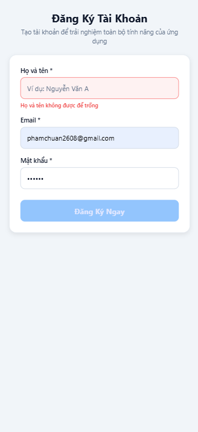
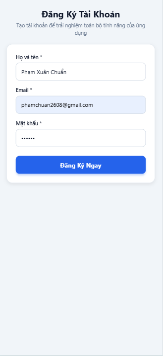

# BÀI THỰC HÀNH LAB 8: TÁCH COMPONENT & VALIDATE FORM REGISTER (REACT NATIVE)

## 1. Yêu Cầu Đề Bài
- **Mục tiêu:** Màn hình Register không nên viết thành một khối lớn. Chia thành các component nhỏ, mỗi component có nhiệm vụ rõ ràng.
- **4 Component bắt buộc:**
  1. `AppHeader`: Nhận tiêu đề màn hình (`title`) và mô tả ngắn (`subtitle`).
  2. `InputField`: Nhận nhãn (`label`), giá trị (`value`), hàm đổi text (`onChangeText`), và thông báo lỗi (`error`).
  3. `PrimaryButton`: Nhận nhãn nút (`title`), sự kiện click (`onPress`), trạng thái vô hiệu hóa (`disabled`).
  4. `Card`: Khung nội dung, có đệm (`padding`), bo góc (`borderRadius`) và đổ bóng.
- **Yêu cầu validate dữ liệu:**
  - Tên không rỗng.
  - Email có ký tự `@`.
  - Mật khẩu từ 6 ký tự.
  - Hiển thị lỗi bằng chữ màu đỏ dưới ô input tương ứng.
  - Tự động **Disable** nút Submit (`PrimaryButton`) khi dữ liệu chưa hợp lệ.
- **Sản phẩm nộp:**
  - Repo source code.
  - Ảnh màn hình Register ở trạng thái **Không hợp lệ** (hiển thị lỗi đỏ, nút Submit bị disable).
  - Ảnh màn hình Register ở trạng thái **Hợp lệ** (không lỗi, nút Submit kích hoạt).

---

## 2. Cấu Trúc Mã Nguồn (Tách Component Rõ Ràng)

```text
Lab8/
├── App.js                         # File khởi chạy ứng dụng chính
├── index.js                       # Entry point cho Expo
├── package.json                   # Cấu hình thư viện dự án
├── app.json                       # Cấu hình Expo
├── src/
│   ├── constants/
│   │   └── colors.js              # Bảng mã màu chuẩn (Primary, Error, Border...)
│   ├── components/                # 4 Component nhỏ độc lập
│   │   ├── AppHeader.js           # [1] Header tiêu đề & mô tả
│   │   ├── Card.js                # [2] Khung Card bo góc, đổ bóng
│   │   ├── InputField.js          # [3] Trường nhập liệu kèm label & lỗi đỏ
│   │   └── PrimaryButton.js       # [4] Nút bấm chính có disable/enable
│   └── screens/
│       └── RegisterScreen.js      # Màn hình ghép nối các component & xử lý validation
└── README.md
```

---

## 3. Chi Tiết Các Component Nhỏ

### [1] `AppHeader` (`src/components/AppHeader.js`)
- **Nhiệm vụ:** Hiển thị tiêu đề trang (`title`) và đoạn mô tả giới thiệu (`subtitle`).
- **Props:**
  - `title` *(string)*: Tiêu đề chính.
  - `subtitle` *(string)*: Mô tả ngắn gọn.
  - `containerStyle` *(object)*: Style tùy chỉnh thêm.

### [2] `Card` (`src/components/Card.js`)
- **Nhiệm vụ:** Tạo khung chứa màu trắng sạch sẽ, có `padding`, `borderRadius` và đổ bóng `shadow`/`elevation`.
- **Props:**
  - `children` *(ReactNode)*: Nội dung bên trong Card.
  - `padding` *(number)*: Mặc định `20`.
  - `borderRadius` *(number)*: Mặc định `16`.
  - `style` *(object)*: Style mở rộng.

### [3] `InputField` (`src/components/InputField.js`)
- **Nhiệm vụ:** Trường nhập thông tin, đổi màu viền sang đỏ khi có lỗi, hiển thị dòng lỗi màu đỏ bên dưới.
- **Props:**
  - `label` *(string)*: Tên nhãn (Họ tên, Email, Mật khẩu).
  - `value` *(string)*: Giá trị input.
  - `onChangeText` *(func)*: Callback khi người dùng gõ phím.
  - `error` *(string)*: Lỗi hiển thị màu đỏ (nếu chuỗi rỗng sẽ không hiển thị).
  - `placeholder`, `secureTextEntry`, `keyboardType`, `onBlur`...

### [4] `PrimaryButton` (`src/components/PrimaryButton.js`)
- **Nhiệm vụ:** Nút bấm hành động chính (Submit).
- **Props:**
  - `title` *(string)*: Chữ hiển thị ("Đăng Ký Ngay").
  - `onPress` *(func)*: Hàm thực hiện khi bấm.
  - `disabled` *(boolean)*: Khi `true` thì nút chuyển sang màu nhạt, không thể bấm được.

---

## 4. Hướng Dẫn Cài Đặt Và Chạy Ứng Dụng

1. Mở terminal tại thư mục `Lab8`:
   ```bash
   cd "C:\Learn\PHAMXUANCHUAN\RN\Learn On School\Lab8"
   ```

2. Cài đặt các thư viện cần thiết:
   ```bash
   npm install
   ```

3. Khởi chạy ứng dụng:
   ```bash
   npx expo start
   ```
   - Nhấn phím `w` để mở xem ngay trên trình duyệt Web.
   - Hoặc quét mã QR bằng ứng dụng **Expo Go** trên điện thoại (Android/iOS).

---

## 5. Kết Quả Thực Nghiệm & Ảnh Chụp Màn Hình Nộp Bài

### 5.1. Trạng Thái Không Hợp Lệ (Invalid)
- **Hiện tượng:** Dữ liệu nhập vào chưa thỏa mãn điều kiện (Họ tên trống, Email thiếu ký tự `@`, Mật khẩu dưới 6 ký tự).
- **Kết quả:** Hiển thị lỗi màu đỏ bên dưới từng trường và nút **"Đăng Ký Ngay"** bị vô hiệu hóa (Disabled).
<p align="center">
  
</p>

### 5.2. Trạng Thái Hợp Lệ (Valid)
- **Hiện tượng:** Nhập đầy đủ và chính xác tất cả các trường theo quy định.
- **Kết quả:** Không còn thông báo lỗi, nút **"Đăng Ký Ngay"** được kích hoạt (Enabled - màu xanh đậm), sẵn sàng submit form.
<p align="center">
  
</p>
